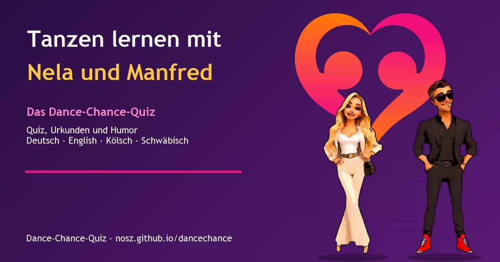

# Tanzen lernen mit Nela und Manfred (Dance-Chance-Quiz)

**Datei:** `index.html` (eine Datei, offline lauffähig, Version 1.2.9, Stand 25.10.2026). Einfach im Browser öffnen oder auf einem Webserver ablegen.

> **Veröffentlichung:** GitHub-Repository `dancechance` (Benutzer `nosz`), Adresse `https://nosz.github.io/dancechance/`. Alle Dateien der Liste unten ins Hauptverzeichnis des Repositories legen (ohne Unterordner; der Ordner `tests` bleibt lokal), GitHub Pages auf den Hauptzweig stellen. Bei anderer Adresse in `index.html` (canonical, og:url, og:image, twitter:image, `SHARE_URL`) und in dieser README anpassen.

## Inhalt
Quiz-Lernspiel mit **8 Tanzstunden** rund um die Online-Tanzschule Dance Chance (https://dance-chance.de/), zwei Figuren, Humor und Urkunden, in **vier Sprachen: Deutsch, Englisch, Kölsch und Schwäbisch** (Umschalter oben: DE, EN, KÖLSCH, SCHWÄB; wird gespeichert).

| Nr. | Tanzstunde | Fragen |
|---|---|---|
| 1 | Hallo, wir sind Manfred & Nela | 3 |
| 2 | Die Grundregeln von Manfred & Nela | 3 |
| 3 | Discofox | 3 |
| 4 | Discowalzer | 3 |
| 5 | Latino | 3 |
| 6 | Breakdance | 3 |
| 7 | Häufige Fragen & Shop | 4 |
| 8 | Bossrunde: Mr. Macs Schlagerparty Berlin | 4 |

- **Kopfzeile:** „Tanzen lernen mit Nela und Manfred“, Sprachumschalter, Teilen, Herzknopf zum Auf-die-Bühne-Holen (💖; gesperrt, solange ein Auftritt läuft), Hell/Dunkel.
- **Start:** Beim Laden kommt **immer der Kuss**: Manfred von rechts, Nela von links, in der Mitte des Bildschirms; nach dem Bussi fliegen Herzen und Küsse nach oben, danach Manfreds überschwängliche Begrüßung („Einen hypergalaktischen und optivamionösen guten Morgen!“), dann Manfreds überschwängliche Begrüßung („Einen hypergalaktischen und optivamionösen guten Morgen!“), dann Begrüßung oder Namensfrage.
- **Zwei Figuren:** **Manfred** (liebevoller Tanzlehrer aus Köln, Brille, rote Schuhe, Kosename „Mr. Mac“, macht Spaß und Werbung für die Schlagerparty Berlin; wechselt zwischen Hochdeutsch und Kölsch) und **Nela** (seine Frau und Tanzpartnerin, elegant, lange blonde Haare, ruhig, holt ihn liebevoll herunter; spricht meist Hochdeutsch und manchmal Schwäbisch). Beide erscheinen nicht immer zusammen und nicht nur unten, sondern auch mitten im Bild, **kopfüber an der Decke**, an der Wand, mit Luftballon, plötzlich mit Funken („Puff“) oder beim Verstecken. Auftritte: Einzelauftritte, Tanz-Tipps, lustige Gespräche, Werbung für die Schlagerparty, **Verfolgungsjagden** (Manfred ist liebevoll frech und haut ab, Nela rennt hinterher), **Tanzen zusammen** (Discofox, Discowalzer, Latino, mit Noten), Stolpern, Gucken vom Rand, Begrüßung, Namensfrage (drängender, höchstens sechsmal) und Lob. Sie sprechen immer in der eingestellten Menüsprache (in „Kölsch“ und „Schwäbisch“ sprechen beide die jeweilige Mundart); beim Sprachwechsel melden sie sich gleich neu. Sprechblasen verdecken nie einen Kopf. Aus bei „Bewegung reduzieren“. Test mit Adresse `?lauf=quer|gucken|manfred|nela|tipp|dialog|werbung|discofox|walzer|latino|stolpern|hallo|morgen|jagd|frech|kletter|decke|versteck|puff|ballon|name|gruss|lob|kuss`.
- **Slider** auf der Startseite (wechselt automatisch weich, mit Pause, Zurück/Weiter und Punkten; bei „Bewegung reduzieren“ ohne Automatik): Schlagerparty Berlin („Von 20 Uhr bis tief in die Nacht“), Tanz-Tanz-Gutschein, Basecap, Weste (Shop, Preise Stand 19.10.2026) und Tanz normal anders (mit Zitat der Gründerin; Telefonnummer und E-Mail werden bewusst nicht gezeigt). **Alle Links zu anderen Seiten öffnen in einem eigenen Browser-Tab.**
- **Empfehlungen** mit Links (Tanzshop Wagenbach, Tanzschule Böhm, Dancing Park Palazzo, Nordstern, Tanz normal anders, pro seniore Residenz Ellental, Blokkus) und **Social Media** (Instagram, TikTok, YouTube); **Impressum, Datenschutz und AGB** von dance-chance.de dezent im Fuß jeder Ansicht.
- **Spielmechanik:** 10 Schritte je richtiger Antwort, 1 bis 3 Sterne je Tanzstunde, 5 Ränge von „Mauerblümchen“ bis „Tanzflächen-Legende“, Konfetti, Hell- und Dunkelmodus.
- **Urkunden:** je Tanzstunde eine Tanz-Urkunde mit den Quiz-Fragen und richtigen Antworten, zum Abschluss die Meister-Urkunde (PNG speichern oder drucken). Sprache der Urkunde = Menüsprache. Unterschrieben „Manfred & Nela“.
- **Teilen:** der größte, gefüllte Knopf auf Ergebnisseite, Urkunden-Seite (auch Meister), Urkunden-Übersicht und Lektionskarten („Urkunde den Freunden zeigen (Angeben erlaubt)“); Text je Tanzstunde mit Link zur App.
- **Installieren-Knopf, PWA:** installierbar, läuft offline, Update-Hinweis. Dateien (alle ins Hauptverzeichnis): `index.html`, `manifest.webmanifest`, `sw.js`, `icon-192.png`, `icon-512.png`, `icon-maskable-512.png`, `favicon.png`, `apple-touch-icon.png`, `dancechance_vorschau.jpg`. Bei jeder neuen Version `VERSION` in `index.html` **und** `sw.js` gemeinsam erhöhen.

## Marke und Look
Farben aus dem Dance-Chance-Herz (Orange `#f39200`, Magenta `#e5167a`, Violett `#a0127a`), dem Farbverlauf von dance-chance.de und dem dunklen Violett der Schlagerparty-Seite (`#2a0e45`), dazu Creme und Gelb `#ffc83d`. Das Herz-Logo (Kopfzeile, Symbole, Urkunde, Shop-Folien) stammt aus der Datei `dancechance-logo.svg`, die der Auftraggeber zur Verfügung gestellt hat; die Verwendung ist mit dem Eigentümer von Dance Chance abgestimmt. Manfred und Nela erscheinen als transparente, hochauflösende 3D-Comic-WebP-Grafiken im Ordner `figures/`.

## Quellen (ausschließlich dance-chance.de, abgerufen 19.10.2026)
- Startseite (mit Häufigen Fragen): https://dance-chance.de/
- Discofox: https://dance-chance.de/discofox/
- Breakdance: https://dance-chance.de/breakdance/
- Discowalzer: https://dance-chance.de/discowalzer/
- Latino: https://dance-chance.de/latino/
- Mr. Macs Schlagerparty: https://dance-chance.de/schlager/
- Schlagerparty Berlin: https://dance-chance.de/berlin/
- Shop: https://dance-chance.de/shop/
- Tanz normal anders: https://dance-chance.de/tanz-normal-anders/
- Rechtliches: https://dance-chance.de/impressum/, https://dance-chance.de/datenschutz/, https://dance-chance.de/agb/

Alle Fakten in Lektionen, Fragen und Sprüchen stammen von diesen Seiten. Die Witze und Dialoge der Figuren sind erfunden (Humor); wo sie Fakten nennen (23. April 2027, Spindler & Klatt, Eventim, 18 € Mindestverzehr), stehen diese auf dance-chance.de.

## Bekannte Grenzen
- Preise, Termine und Angebote ändern sich. **Ticketpreise und Monatspreis stehen bewusst nicht im Quiz** (die Seite nennt für die Mitgliedschaft teils 39 €, teils 10 €). Im Slider stehen die Shop-Preise mit „Stand 19.10.2026“; sie müssen bei Änderungen im Shop angepasst werden (Texte `g1p`, `g2p`, `g3p`).
- Die Seiten nennen „über 150“ (Startseite) und „über 140“ (Discofox) Videos; das Quiz sagt „über 140“.
- Kölsch und Schwäbisch sind liebevoll gemeint und keine Rechtschreibnorm; **Muttersprachler sollten die Texte gegenlesen**, ebenso die englischen Texte.
- Jahreszahlen zu Kennenlernen (2010) und Heirat (2016) stammen von den Coach-Seiten (Discofox, Discowalzer) und wurden auf die App-Figuren übertragen.
- Kontaktdaten von Personen werden nicht verwendet (keine Telefonnummer, keine E-Mail-Adressen).
- Links zu Instagram, TikTok und YouTube hängen von den Konten ab, die auf dance-chance.de verlinkt sind.

## Changelog
- 1.4.0 (25.10.2026): Neue Outfit-Modenschau für Nela und Manfred als in der App erreichbare Bildgalerie ergänzt; Versionsnummer in App-Fußzeile und Service Worker synchronisiert. Hinweis: Die Modenschau ist eine visuelle Vorschau. Die animierten Figuren verwenden weiterhin die bestehenden transparenten Figurenbilder; neue Kleidungsformen sind noch nicht als einzelne transparente Animations-Assets integriert.
- 1.2.9 (25.10.2026): Startkuss überarbeitet: Figuren bleiben zusammen in der Mitte, lehnen sich sichtbar zueinander und halten den Kuss kurz, statt sofort wieder auseinanderzugehen. Sieben wechselnde Farblooks für die Outfits bei neuen Auftritten.

- 1.2.6 (24.10.2026): Teilen und Zertifikat-Download in App-Browsern (Facebook, Instagram, Messenger) repariert: Erkennung mit Hinweis "Im Browser öffnen", Zertifikat-Bild zum Speichern per langem Druck, Fehlerbehandlung beim Download.
- 1.2.4 (23.10.2026): **Fehler behoben: Die Seite scrollte beim Lesen von selbst nach oben** (der Namens-Hinweis zog die Seite zum Namensfeld; sie scrollt jetzt nie mehr von selbst, das Feld pulsiert nur, wenn es sichtbar ist). **Autoren-Knopf** mit deutlichem Link-Symbol, Symbol für externe Seite und sichtbarer Adresse. **Name-Knopf heißt jetzt „Speichern“** (statt „Das bin ich“), mit Speichern-Symbol; er ist grau, solange das Feld leer ist, wird aktiv und pulsiert bei neuem Text und zeigt „Gespeichert“ (grün), wenn nichts mehr zu speichern ist; nach dem Speichern erscheint eine Bestätigung. Version angehoben.
- 1.2.3 (23.10.2026): Autoren-Hinweis im Fuß als auffälliger Knopf überarbeitet (ganzer Text ist der Link auf https://nosz.github.io/norbert-szpak/); Version angehoben, alle Tests und die Link-Pflicht-Prüfung erneut.
- 1.2.2 (23.10.2026): Im Fuß steht jetzt „Website Design by Norbert“ statt „Created by Norbert“ (auffälliger Knopf unter der Version, der ganze Text ist der Link auf https://nosz.github.io/norbert-szpak/).
- 1.2.1 (20.10.2026): Im Fuß steht neben der Version „Created by Norbert“ statt des Datums (kein Link neben Impressum, Datenschutz und AGB).
- 1.2.0 (19.10.2026): **Manfreds Begrüßung:** er wünscht überschwänglich einen guten Morgen, Tag oder Abend (Tageszeit nach der Uhr) aus einem Baukasten mit zwei oder drei Wortungetümen, z. B. „Einen hypergalaktischen und optivamionösen guten Morgen“ oder „Einen wunderschönen gigantischen guten Tag“ (10 Vorlagen, 28 Wörter je Sprache, in allen vier Sprachen); Nela antwortet trocken-humorvoll (30 Antworten, 18 davon beziehen sich auf genau die Wörter, die Manfred gewählt hat). Zu hören beim Start nach dem Kuss, im eigenen Begrüßungs-Auftritt (`?lauf=morgen`) und manchmal in Einzelauftritten.
- 1.1.0 (19.10.2026): **Vier Sprachen** (Schwäbisch neu im Menü oben), Heldin heißt überall **Nela**, **Start immer der Kuss** (Manfred von rechts, Nela von links, in der Mitte des Bildschirms, danach fliegen Herzen und Küsse nach oben), **Überraschungen:** die Figuren erscheinen auch einzeln, mitten im Bild, kopfüber an der Decke, an der Wand, mit Luftballon, plötzlich mit Funken oder beim Verstecken; **Verfolgungsjagden** (Manfred ist frech und haut ab, Nela rennt hinterher), Tanzen zusammen mit Noten, neue lustige Dialoge, Sprechblasen verdecken keinen Kopf. **Slider** (Party, Shop, Tanz normal anders) mit weichem Überblenden und Pause, **Empfehlungen** mit Links, **Social Media**, **Impressum/Datenschutz/AGB** dezent im Fuß, neue Tanzstunde **Häufige Fragen & Shop**, alle Links zu anderen Seiten öffnen in einem eigenen Tab, Vorschaubild und Beschreibung nennen alle vier Sprachen, Hinweis „inoffiziell“ entfernt (Erlaubnis des Eigentümers).
- 1.0.0 (19.10.2026): Neues Projekt auf Basis des HSV-Fanquiz (Version 1.3.0): sieben Tanzstunden mit Quellen von dance-chance.de, zwei 3D-Comic-Figuren Manfred und Nela (Kölsch und Schwäbisch als Charakterzug), Farben und Herz-Logo von Dance Chance, Teilen-Knopf überall, Urkunden mit Quiz-Infos in Menüsprache.

### Figuren-Assets (Version 1.2.6)

Die dekorativen Figuren werden als transparente WebP-Dateien aus `figures/manfred.webp` und `figures/nela.webp` geladen. Der Service Worker cached beide Assets für den Offline-Betrieb. Manfreds festes Markenzeichen sind Sonnenbrille und rote Schuhe; Nela trägt lange blonde Haare und ein elegantes Outfit.
